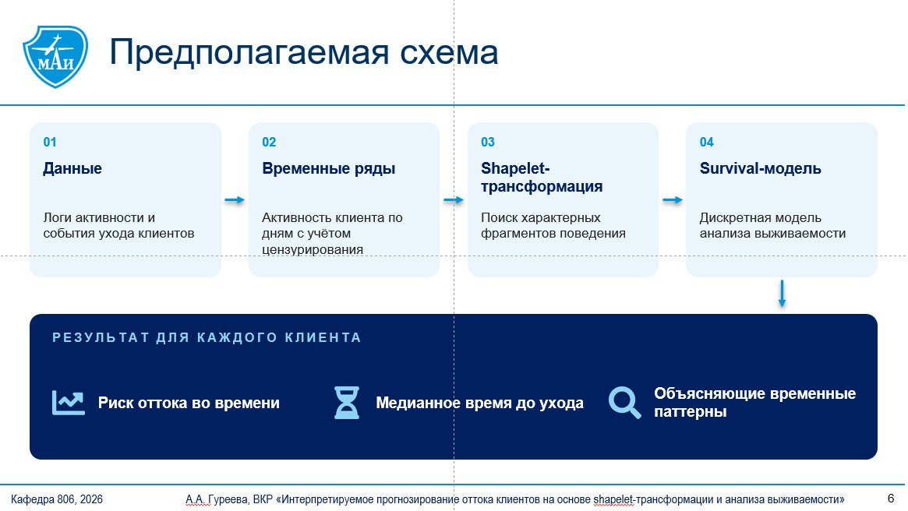

# Survival of the Loyal

Shapelet-признаки и анализ выживаемости для прогнозирования оттока

Институт № 8 «Компьютерные науки и прикладная математика»  
Кафедра 806 «Вычислительная математика и программирование»  
Направление: 02.04.02 Фундаментальная информатика и ИТ

Выпускная квалификационная работа магистра

**Тема: «Разработка интерпретируемой модели прогнозирования оттока клиентов на основе shapelet-трансформации и анализа выживаемости»**

Выполнил студент группы М8О-202СВ-25  
Гуреева Алина Алексеевна

Руководитель:  
Полей-Добронравова Амелия Вадимовна

---

## Актуальность и цель работы

1. Удержание существующих клиентов обходится компаниям значительно дешевле привлечения новых, поэтому прогнозирование оттока является одной из ключевых задач в банковской сфере, телекоммуникациях и подписочных сервисах.
2. Для своевременного принятия мер по удержанию необходимо оценивать не только вероятность ухода клиента, но и ожидаемое время до этого события, а также его причины.
3. Распространённые модели классификации не учитывают время до наступления события и обладают низкой интерпретируемостью, а агрегированные признаки не отражают динамику поведения клиента.

**Цель работы:** Разработка модели прогнозирования времени до оттока клиентов на основе shapelet-признаков временных рядов и методов анализа выживаемости, позволяющей объяснять риск оттока через характерные паттерны поведения клиентов

## Задачи исследования

1. Провести анализ существующих методов прогнозирования оттока клиентов, анализа выживаемости и shapelet-трансформации временных рядов
2. Отобрать и предобработать наборы данных, содержащие временные ряды поведения клиентов, события ухода и цензурированные наблюдения
3. Реализовать извлечение shapelet-признаков, отражающих характерные паттерны поведения клиентов, такие как снижение активности или всплески обращений в поддержку
4. Построить дискретную модель анализа выживаемости на основе shapelet-признаков для оценки риска оттока и медианного времени до ухода клиента
5. Провести сравнительную оценку предложенного подхода с базовыми моделями, использующими агрегированные признаки
6. Выполнить интерпретацию выявленных временных паттернов и оценить их влияние на риск оттока

## Объект и предмет исследования

**Объект исследования:** Поведение клиентов подписочных и финансовых сервисов, представленное временными рядами активности

**Предмет исследования:** Методы shapelet-трансформации и анализа выживаемости для интерпретируемого прогнозирования времени до оттока

## Схема предлагаемого подхода

## Научная новизна

### 1. Новый тип признаков для survival-моделей

- **Традиционно:** Статичные агрегаты: среднее, сумма, тренд за период
- **В работе:** Shapelet-признаки, сохраняющие форму динамики поведения

### 2. Интерпретируемость на уровне временных паттернов

- **Традиционно:** Вклад отдельных признаков в прогноз модели
- **В работе:** Конкретный фрагмент поведения, повышающий риск оттока

## Стек технологий

| | |
|---|---|
| **Данные и вычисления** | Python, pandas, Polars, NumPy |
| **Временные ряды** | aeon, sktime: Shapelet Transform, RDST, MiniRocket |
| **Анализ выживаемости** | scikit-survival, lifelines, pycox: модель Кокса, случайный лес выживаемости, DeepHit |
| **Машинное обучение** | XGBoost, CatBoost для базовых моделей |
| **Интерпретация** | SHAP, SurvSHAP(t), визуализация шейплетов |
| **Инфраструктура** | Jupyter, Git, GitHub, matplotlib, seaborn |

**Данные:** KKBox Churn Prediction (WSDM Cup 2018) · FinSurvival (DeFi-кредитование)

## Практическая значимость

- **Своевременное удержание.** Прогноз времени до ухода показывает, когда нужно действовать
- **Понятные причины оттока.** Риск объясняется конкретным паттерном поведения клиента
- **Широкая применимость.** Банки, телеком, подписочные сервисы и маркетплейсы

## Ожидаемые результаты

Результат по каждой задаче:

| № | Результат |
|---|---|
| 1 | Аналитический обзор методов прогнозирования оттока, анализа выживаемости и shapelet-трансформации, обоснование выбранного подхода |
| 2 | Отобранные и предобработанные наборы данных (KKBox, FinSurvival) с временными рядами поведения, событиями ухода и цензурированием |
| 3 | Программная реализация извлечения shapelet-признаков и набор выделенных паттернов поведения клиентов |
| 4 | Дискретная модель анализа выживаемости, оценивающая риск оттока и медианное время до ухода клиента |
| 5 | Результаты сравнения с базовыми моделями по индексу согласованности и интегральной оценке Брайера |
| 6 | Перечень временных паттернов, повышающих риск оттока, с оценкой их влияния на прогноз |
